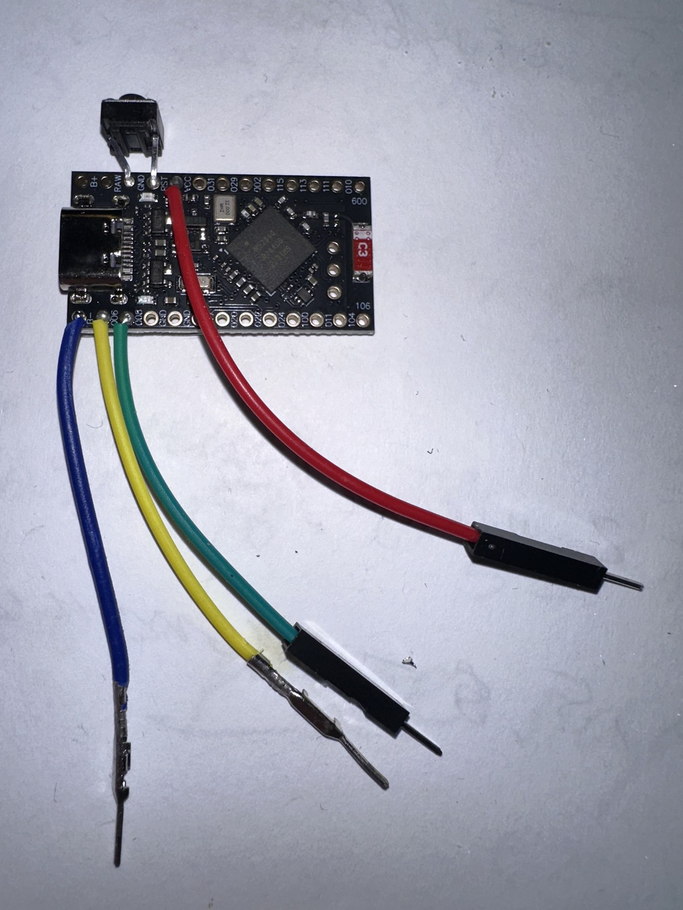
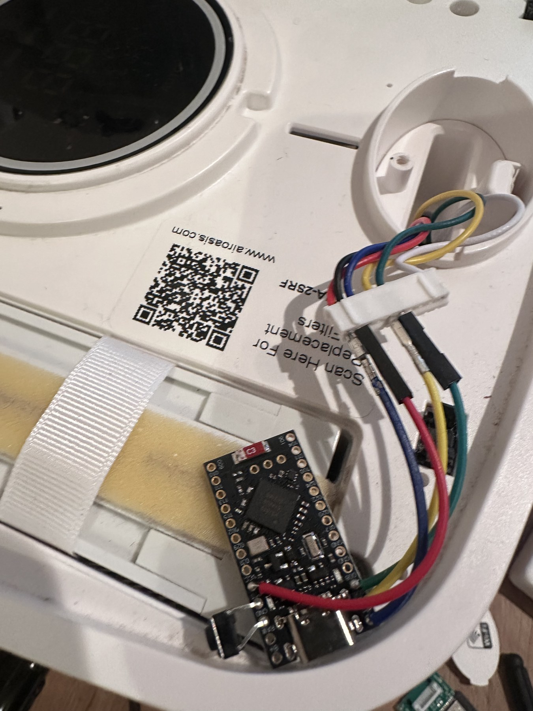

# Hardware, build, and flashing

## Controller board

The firmware targets a **Teyleten Pro Micro-form-factor nRF52840** board that
presents a nice!nano-compatible `NICENANO` UF2 volume. It has an nRF52840-QIAA
with 3.3 V logic and an Adafruit-compatible S140 v6 / UF2 bootloader. The
supplied memory layout depends on that bootloader.

| Board label | nRF pin | Use |
|---|---|---|
| `008` / `D0` | `P0.08` | UART TX |
| `006` / `D1` | `P0.06` | UART RX |
| `GND` | — | Ground |
| `VCC` | 3.3 V | Board power input when not USB powered |

Use the pin names printed on the board, not header positions. The board used
for this project matched the
[teyleten-nrf52840-pinout](https://github.com/longrackslabs/teyleten-nrf52840-pinout)
reference. Other boards require a port and validation.

## Build

Install the nRF Connect SDK 3.4.0 toolchain and `west`. From the repository
root:

```sh
west init -l ncs
west update
west zephyr-export
west build --no-sysbuild -p always -b aoia_nrf52840 ncs -d ncs/build
make -C tests test
```

The build artifact is `ncs/build/zephyr/zephyr.uf2`.

## Flash

Use USB as the board's only power source while flashing; do not connect J1
`VCC_3V3` at the same time.

1. Connect USB-C and enter the installed UF2 bootloader, normally by
   double-tapping reset.
2. Confirm that the board mounts as `NICENANO`.
3. Copy the generated UF2:

   ```sh
   cp ncs/build/zephyr/zephyr.uf2 /Volumes/NICENANO/
   ```

The volume unmounting after the copy is the expected reboot behavior. Do not
mass-erase the board: this repository does not include a replacement
bootloader or SoftDevice image.

## Purifier connection

After flashing, disconnect USB before connecting the purifier. The target is
the low-voltage **J1** connector. Its UART is 9600 baud, 8N1, no flow control.

| nRF52840 board | J1 wire / original Wi-Fi board label | Purpose |
|---|---|---|
| `008` / `D0` / `P0.08` (TX) | `UART_TX` (purifier RX) | Board sends commands |
| `006` / `D1` / `P0.06` (RX) | `UART_RX` (purifier TX) | Board receives state |
| `GND` | `GND` | Common reference |

The J1 UART names are from the original Wi-Fi board's perspective. On the
purifiers used for this project, **red is ground** and **black is 3.3 V**.
Follow board silkscreen rather than wire colors.

For installed operation, connect J1 `VCC_3V3` to board `VCC` and retain the
common J1/board ground. Use either USB power or J1 3.3 V—never both. Disconnect
the original controller from J1 before connecting the nRF52840 board.

## Wiring

| Board-side UART wiring | Installed low-voltage connection |
|---|---|
|  |  |

## First startup

1. Re-check the TX/RX connections and shared ground.
2. Confirm that only one 3.3 V source is connected.
3. Commission the device in ZHA.
4. Test each control individually and confirm both the appliance response and
   Zigbee state update.

USB CDC ACM diagnostics are separate from the purifier UART. Use USB
diagnostics only with J1 `VCC_3V3` disconnected.
